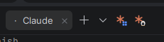
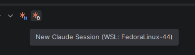

# Claude Terminal Tab Persistence

A JetBrains Rider / IntelliJ plugin that keeps your [Claude Code](https://claude.com/claude-code) terminal tabs across IDE restarts, crashes and reboots.

## What it does

- **Your sessions restore automatically, right where you left off.** Every Claude tab that was open reopens in the same order, under the same name, and resumes its conversation. Close a tab with × and it stays closed.
- **Works with more than one Claude subscription, with or without WSL.** On Windows, the Windows Claude and the Claude inside each WSL distro are each tracked and restored through their own installation and login, so each can be on a different account. With more than one, the terminal toolbar shows one Claude button per installation, marked with its platform. Without WSL, it simply uses your local Claude.




## Install

**Settings → Plugins → Marketplace → search "Claude Terminal Tab Persistence" → Install → restart.**

Everything else (scripts, commands, CLAUDE.md section, permissions) is set up on first start.

## Slash commands

| Command | What it does |
|---|---|
| `/tab [name]` | Renames this tab and snapshots it to history. If no name is given, Claude picks one (3–5 words) based on the current conversation. |
| `/tabs-status` | Shows every active Claude session grouped by project, with session IDs. |
| `/tabs-backup` | Writes currently-active sessions into history so you can resume them later, without waiting for the tab to close. |
| `/tabs-history` | Numbered list of past closed/backed-up sessions (newest first). Pick one to resume. |
| `/tabs-restore` | Lists recent sessions by name and reopens the ones you pick as tabs, within seconds — no commands to paste. |
| `/tabs-recover` | Rebuilds the tab snapshot after a crash, so the plugin reopens the sessions that were really open. Dry-runs first; recovers the last 60 minutes by default (`/tabs-recover --within 180`). |
| `/tabs-clear` | Clears the rename cache and per-project restore files. Doesn't touch history. |

## Config

Optional. `~/.claude/rider-plugin/config.json`:

```json
{
  "historyMaxAgeDays": 90,
  "snapshotKeepCount": 10
}
```

Restart Rider after editing.

## Compatibility

- Rider / IntelliJ 2026.1+
- Windows primary. macOS / Linux should work but less tested.
- Sessions started inside WSL are tracked and restored too; the commands are installed into each running distro's `~/.claude` as well as the Windows one.
- Requires Claude Code CLI (provides the `node` runtime the plugin's scripts use).

## Files it writes

All under `~/.claude/rider-plugin/`:

```
active-sessions/<sid>.json      # one file per alive session (name, order, cwd)
open-tabs-<project>.json        # the open-tab snapshot restored on next launch
session-backlog.json            # last 50 evicted sessions (for /tabs-history)
config.json                     # user overrides
state-root.json                 # WSL homes only: where the Windows-side state dir lives
```

## Running the tests

```bash
./gradlew test        # Unit + storage + slash-command scripts (fast, no IDE needed)
./gradlew uiTest      # UI tests via Remote Robot (optional, needs a sandbox IDE)
```

For the UI tests, start a sandbox IDE in another terminal first:

```bash
./gradlew runIdeForUiTests
```

Then run `uiTest` — it connects over RMI on port 8082. If no sandbox is running, UI tests skip gracefully (so a plain `./gradlew test` stays green without one).

No tests require network access, Anthropic API keys, or a real Claude install.

## Uninstall

Plugins page → Uninstall → restart. All deployed files are removed.

## License

Licensed under the [Mozilla Public License 2.0](LICENSE). Free for personal and commercial use. You can modify, distribute, and bundle it; changes to MPL-covered files must remain under MPL-2.0 and be made available, but proprietary code that *uses* the plugin is unaffected.

## Issues / PRs

[github.com/Ragnaraven/RiderClaudeTabs](https://github.com/Ragnaraven/RiderClaudeTabs)
